<div align="center">

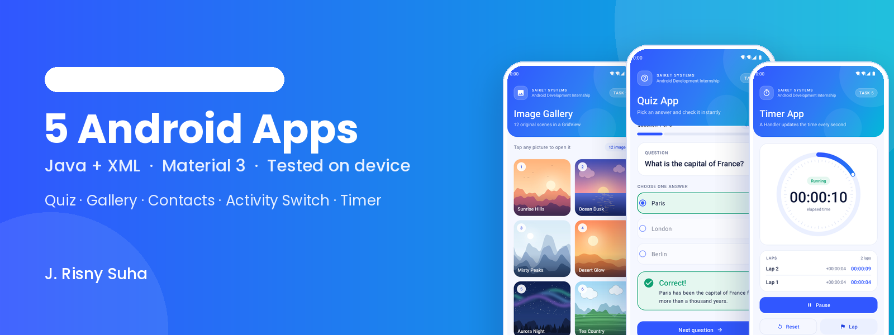

# SaiKet Systems · Android Development Internship

**Five separate Android apps, one for each task level, written in Java with XML layouts.**

[](https://github.com/DevRisny/SaiKet_Android_Development_Internship/actions/workflows/android.yml)
[](https://github.com/DevRisny/SaiKet_Android_Development_Internship/actions/workflows/device-tests.yml)

-03b8d9?style=flat-square&logo=android&logoColor=white)
-3157ff?style=flat-square)


[**⬇ Download the 5 APKs**](https://github.com/DevRisny/SaiKet_Android_Development_Internship/releases/latest) ·
[Demo video](#-demo-video) ·
[Screenshots](#-screenshots) ·
[How each task is solved](#-how-each-task-is-solved) ·
[Testing](#-testing)

</div>

---

## 📌 At a glance

| | Task | App | What it shows | Key Android parts |
|:-:|---|---|---|---|
| 1 | **Simple Quiz App** | QuizSpark | 5 questions, instant "Correct!" / "Incorrect", final score | `TextView`, `RadioGroup` + `RadioButton`, `OnClickListener` |
| 2 | **Simple Image Gallery** | PixelGrid | 12 original pictures in a grid, tap to open | `GridView`, custom `BaseAdapter`, `OnItemClickListener`, `res/drawable` |
| 3 | **Display List of Contacts** | ContactBook | Names and numbers from the phone, search, tap to call | `READ_CONTACTS`, runtime permission, `ContentResolver`, `ListView` |
| 4 | **Switch Between Activities** | Relay | Message from ActivityOne shown in ActivityTwo, reply sent back | `Intent` extras, `ActivityResultLauncher`, `setResult()` |
| 5 | **Simple Timer App** | Tempo | Time updates every second, Start / Pause / Reset, laps | `Handler` + `Runnable`, `SystemClock`, custom ring `View` |

Every task is its **own app module** with its own package, launcher icon and APK, as the brief asks ("make a separate file of each level").

---

## 🎬 Demo video

<div align="center">

<a href="docs/SaiKet_Android_Internship_Demo.mp4">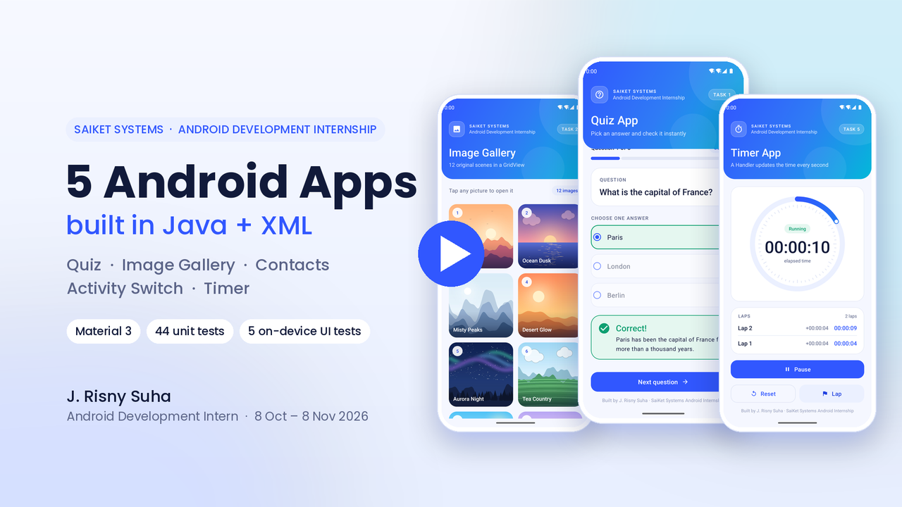</a>

**▶ [Watch the full demo video (1080p, ~1:50)](docs/SaiKet_Android_Internship_Demo.mp4)**: every app running on an Android 14 emulator, recorded during the UI tests.

</div>

---

## 📱 Screenshots

All screenshots below are real captures from an Android 14 emulator, taken automatically by the UI tests in [`device-tests.yml`](.github/workflows/device-tests.yml).

### Task 1 · Quiz App

<table>
<tr>
<td align="center">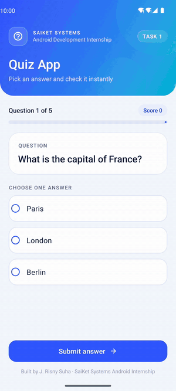<br/><sub><b>Live demo</b></sub></td>
<td align="center">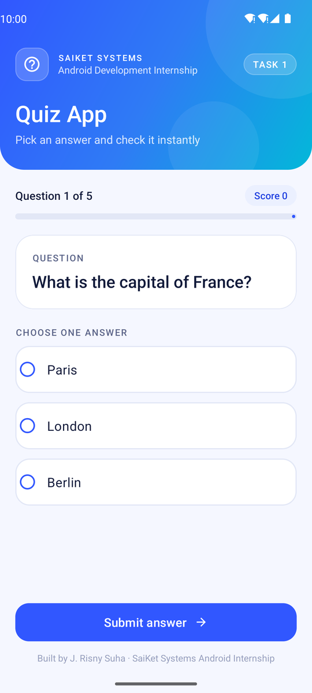<br/><sub>Question</sub></td>
<td align="center">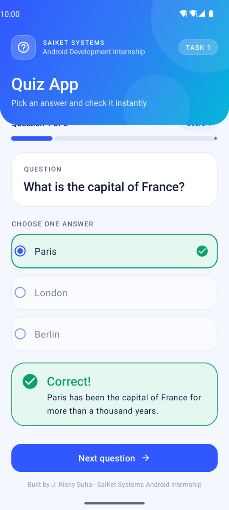<br/><sub>Correct!</sub></td>
<td align="center">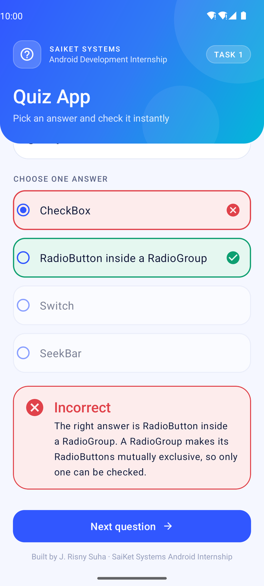<br/><sub>Incorrect</sub></td>
<td align="center">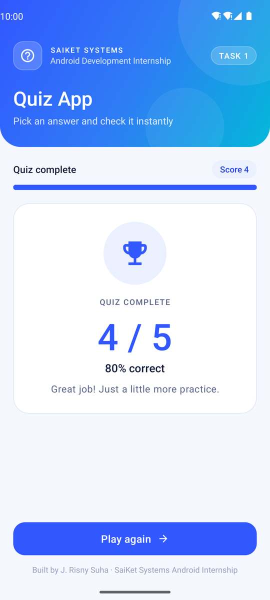<br/><sub>Final score</sub></td>
</tr>
</table>

### Task 2 · Image Gallery

<table>
<tr>
<td align="center">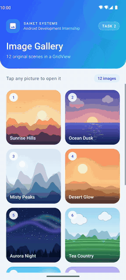<br/><sub><b>Live demo</b></sub></td>
<td align="center"><br/><sub>GridView</sub></td>
<td align="center">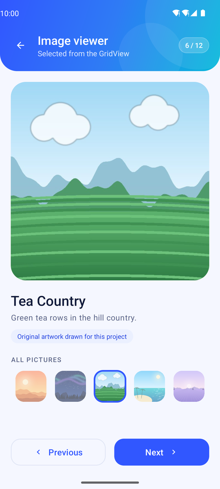<br/><sub>Tapped picture</sub></td>
<td align="center">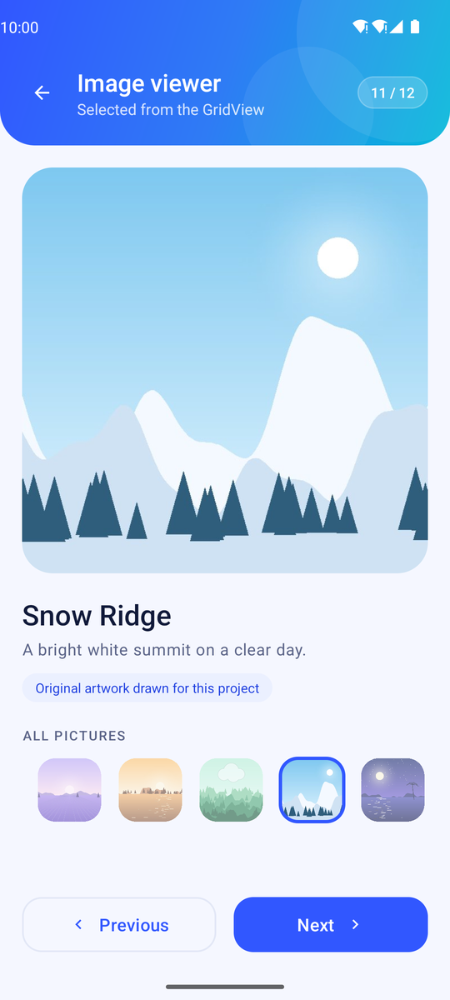<br/><sub>Thumbnail strip</sub></td>
<td align="center">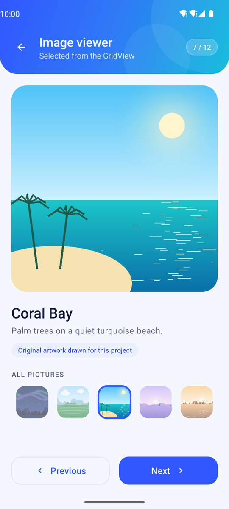<br/><sub>Next picture</sub></td>
</tr>
</table>

### Task 3 · Contacts

<table>
<tr>
<td align="center">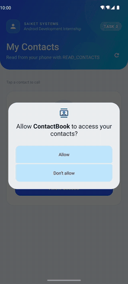<br/><sub><b>Live demo</b></sub></td>
<td align="center">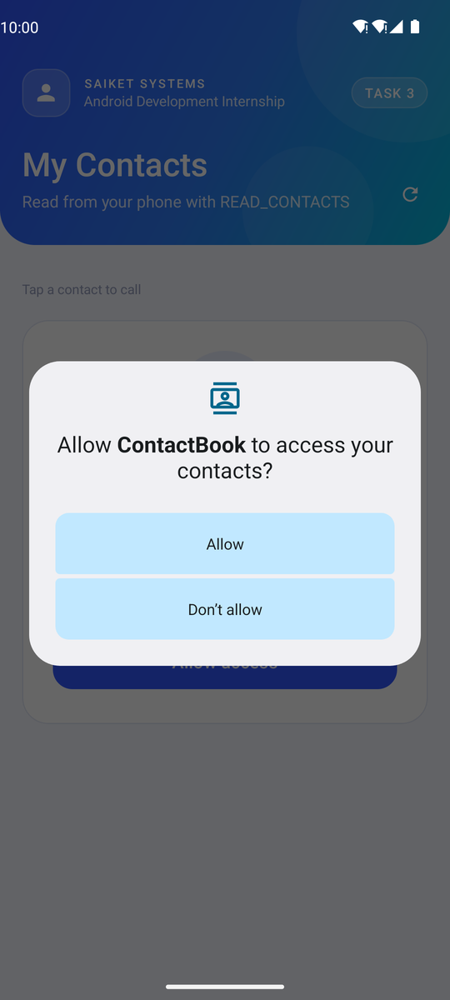<br/><sub>READ_CONTACTS</sub></td>
<td align="center">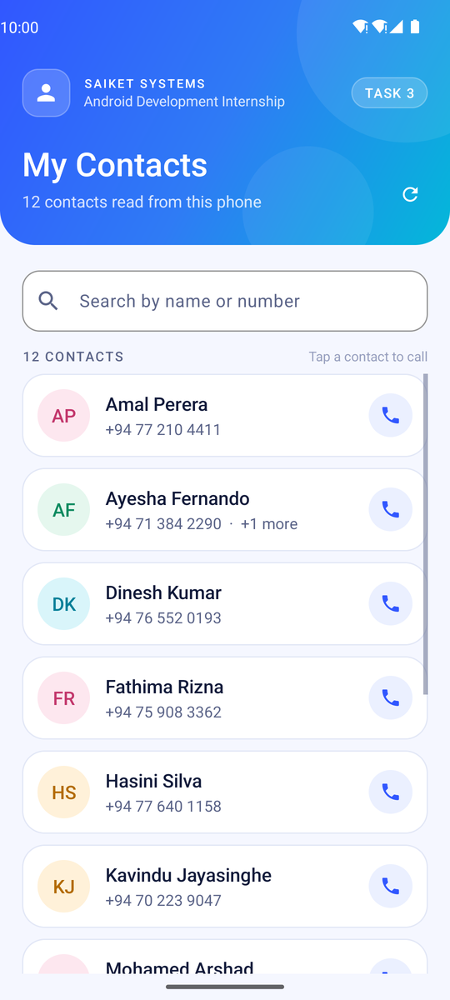<br/><sub>ListView</sub></td>
<td align="center">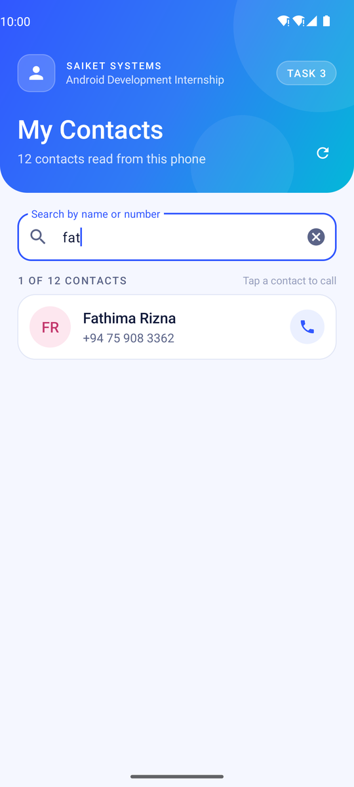<br/><sub>Search</sub></td>
</tr>
</table>

### Task 4 · Activity Switch

<table>
<tr>
<td align="center">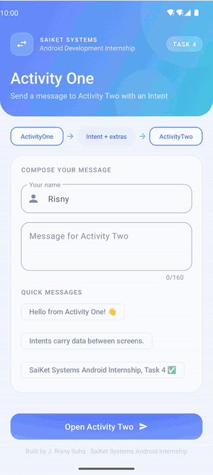<br/><sub><b>Live demo</b></sub></td>
<td align="center">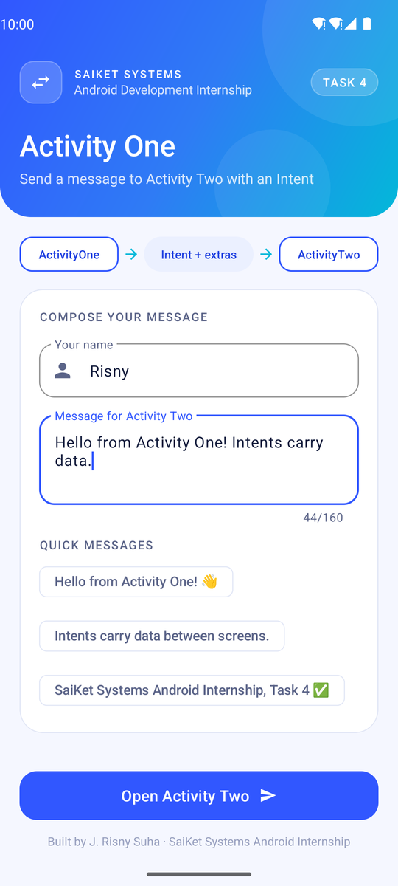<br/><sub>ActivityOne</sub></td>
<td align="center">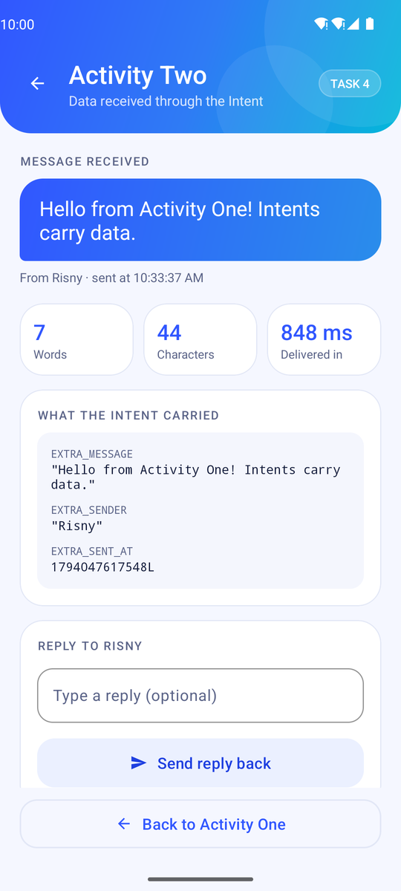<br/><sub>ActivityTwo</sub></td>
<td align="center">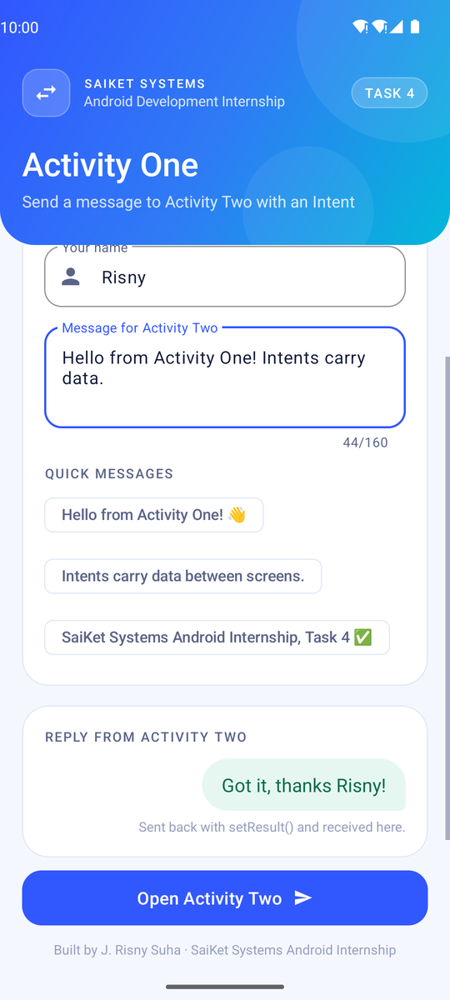<br/><sub>Reply came back</sub></td>
</tr>
</table>

### Task 5 · Timer

<table>
<tr>
<td align="center">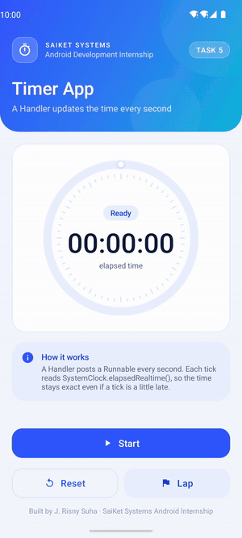<br/><sub><b>Live demo</b></sub></td>
<td align="center">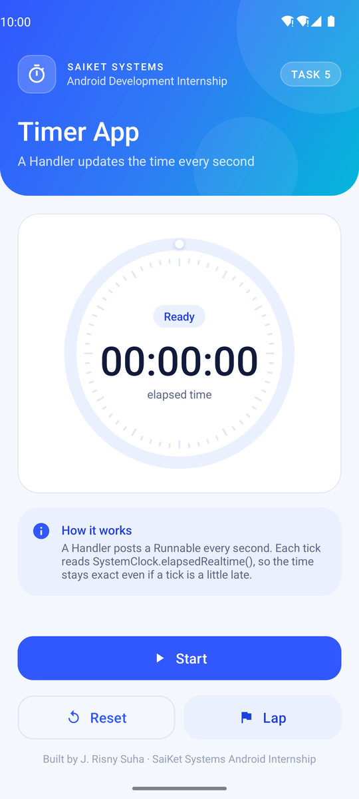<br/><sub>Ready</sub></td>
<td align="center">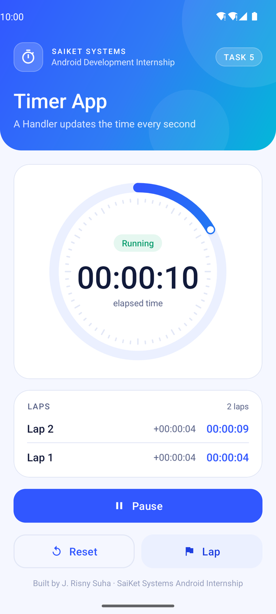<br/><sub>Running + laps</sub></td>
<td align="center">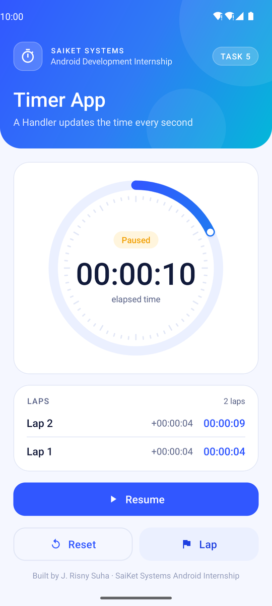<br/><sub>Paused</sub></td>
</tr>
</table>


---

## 🛠 How each task is solved

### Task 1 · Simple Quiz App — `Task1_QuizApp`

| Brief step | Where it is done |
|---|---|
| 1. Layout with a `TextView` question, `RadioButton` answers and a Submit `Button` | [`activity_main.xml`](Task1_QuizApp/src/main/res/layout/activity_main.xml) |
| 2. Define the question in `MainActivity` (Capital of France: Paris, London, Berlin) | Question 1 in [`QuizBank.java`](Task1_QuizApp/src/main/java/com/risnysuha/saiket/quiz/QuizBank.java), loaded by `MainActivity` |
| 3. `OnClickListener` on Submit checks the selected answer | `onPrimaryClicked()` in [`MainActivity.java`](Task1_QuizApp/src/main/java/com/risnysuha/saiket/quiz/MainActivity.java) |
| 4. Disable the `RadioButton`s and show "Correct!" or "Incorrect" | `render()` calls `setEnabled(false)` and shows the result card |
| 5. Test | [`QuizEngineTest`](Task1_QuizApp/src/test/java/com/risnysuha/saiket/quiz/QuizEngineTest.java) (12 unit tests) + [`QuizAppTest`](Task1_QuizApp/src/androidTest/java/com/risnysuha/saiket/quiz/QuizAppTest.java) (on device) |

**Extras:** 4 more Android questions, the right answer turns green and a wrong one red, a short explanation after each answer, a progress bar, a final score screen with "Play again", a shake if Submit is pressed with nothing chosen, and the quiz survives screen rotation.

### Task 2 · Simple Image Gallery — `Task2_ImageGallery`

| Brief step | Where it is done |
|---|---|
| 1. `GridView` layout, images in `res/drawable` | [`activity_main.xml`](Task2_ImageGallery/src/main/res/layout/activity_main.xml), 12 images in [`res/drawable-nodpi`](Task2_ImageGallery/src/main/res/drawable-nodpi) |
| 2. Adapter loads the images | [`ImageAdapter.java`](Task2_ImageGallery/src/main/java/com/risnysuha/saiket/gallery/ImageAdapter.java) (`BaseAdapter` with a ViewHolder) |
| 3. `OnItemClickListener` for image selection | [`MainActivity.java`](Task2_ImageGallery/src/main/java/com/risnysuha/saiket/gallery/MainActivity.java) opens [`ImageViewerActivity`](Task2_ImageGallery/src/main/java/com/risnysuha/saiket/gallery/ImageViewerActivity.java) |
| 4. Test | [`GalleryNavigatorTest`](Task2_ImageGallery/src/test/java/com/risnysuha/saiket/gallery/GalleryNavigatorTest.java) + [`GalleryAppTest`](Task2_ImageGallery/src/androidTest/java/com/risnysuha/saiket/gallery/GalleryAppTest.java) |

**Extras:** all 12 pictures are **original artwork drawn in code for this project** (no copied images), square rounded cells, 2 columns in portrait and 4 in landscape, a zoom animation into the viewer, and Previous / Next that wrap around.

### Task 3 · Display List of Contacts — `Task3_ContactsList`

| Brief step | Where it is done |
|---|---|
| 1. `READ_CONTACTS` in `AndroidManifest.xml` | [`AndroidManifest.xml`](Task3_ContactsList/src/main/AndroidManifest.xml) + runtime request with `ActivityResultContracts.RequestPermission` |
| 2. `ContentResolver` query for name and phone number | [`ContactsRepository.java`](Task3_ContactsList/src/main/java/com/risnysuha/saiket/contacts/ContactsRepository.java), run on a background thread |
| 3. Show the names in a `ListView` | [`ContactAdapter.java`](Task3_ContactsList/src/main/java/com/risnysuha/saiket/contacts/ContactAdapter.java) + [`activity_main.xml`](Task3_ContactsList/src/main/res/layout/activity_main.xml) |
| 4. Test on a device | [`ContactsAppTest`](Task3_ContactsList/src/androidTest/java/com/risnysuha/saiket/contacts/ContactsAppTest.java) taps **Allow** on the real permission dialog and checks the list |

**Extras:** one row per person even when they have several numbers (duplicates removed), coloured initials avatars, live search by name or digits, tap a contact to open the dialer, and clear screens for "permission needed", "open Settings" (after a permanent denial) and "no contacts".

### Task 4 · Simple Switch Between Activities — `Task4_ActivitySwitch`

| Brief step | Where it is done |
|---|---|
| 1. Two activities, a Button in `ActivityOne` opens `ActivityTwo` | [`ActivityOne.java`](Task4_ActivitySwitch/src/main/java/com/risnysuha/saiket/activityswitch/ActivityOne.java), [`ActivityTwo.java`](Task4_ActivitySwitch/src/main/java/com/risnysuha/saiket/activityswitch/ActivityTwo.java) |
| 2. Pass a string message with an `Intent` | `intent.putExtra(IntentKeys.EXTRA_MESSAGE, …)` (plus sender name and time) |
| 3. `ActivityTwo` reads the `Intent` and shows the data in a `TextView` | `getIntent().getStringExtra(…)` → `received_message` |
| 4. Test navigation | [`ActivitySwitchTest`](Task4_ActivitySwitch/src/androidTest/java/com/risnysuha/saiket/activityswitch/ActivitySwitchTest.java) |

**Extras:** message check (empty / too long), quick-message chips, word and character counts, how long the Intent took to arrive, a panel showing every extra the Intent carried, slide animations, and a **reply sent back** to ActivityOne with `setResult()`.

### Task 5 · Simple Timer App — `Task5_TimerApp`

| Brief step | Where it is done |
|---|---|
| 1. `TextView` for the time, Start and Reset buttons | [`activity_main.xml`](Task5_TimerApp/src/main/res/layout/activity_main.xml) |
| 2. `Handler` updates the `TextView` every second | `ticker` Runnable in [`MainActivity.java`](Task5_TimerApp/src/main/java/com/risnysuha/saiket/timer/MainActivity.java) |
| 3. Start begins; Reset stops and goes back to zero | `start_button` and `reset_button` listeners, logic in [`Stopwatch.java`](Task5_TimerApp/src/main/java/com/risnysuha/saiket/timer/Stopwatch.java) |
| 4. Test | [`StopwatchTest`](Task5_TimerApp/src/test/java/com/risnysuha/saiket/timer/StopwatchTest.java) (11 tests) + [`TimerAppTest`](Task5_TimerApp/src/androidTest/java/com/risnysuha/saiket/timer/TimerAppTest.java) |

**Extras:** the time is worked out from `SystemClock.elapsedRealtime()`, so it never drifts even if a tick is late; each tick is lined up to the next whole second; Pause / Resume; laps with split times; a custom ring that fills once a minute; and the timer keeps going across screen rotation.

---

## 🎨 Design

- One light design system shared by all five apps: SaiKet blue `#3157FF` and cyan `#03B8D9` on a soft `#F5F7FF` background, Material 3 components, rounded cards and large touch targets.
- Edge-to-edge screens with a gradient header behind the status bar; content is kept clear of the system bars and the keyboard.
- Each app has its own adaptive launcher icon.

---

## 🧪 Testing

| Kind | What | Where it runs |
|---|---|---|
| **Unit tests** | 44 JUnit tests for the plain-Java logic (quiz engine, gallery navigation, contact helpers, message checks, stopwatch) | Every push, [Android CI](.github/workflows/android.yml) |
| **UI tests** | 5 Espresso / UI Automator tests, one full user journey per app | Android 14 emulator, [Device UI tests](.github/workflows/device-tests.yml) |

The device workflow also fills the emulator with sample contacts, records each app's screen and saves the screenshots used above.

```bash
./gradlew testDebugUnitTest            # unit tests for all five apps
./gradlew connectedDebugAndroidTest    # UI tests (needs a device or emulator)
```

---

## 🚀 Run it yourself

1. Clone the repo and open the folder in **Android Studio** (JDK 17).
2. Pick one of the five run configurations: `Task1_QuizApp` … `Task5_TimerApp`.
3. Press **Run**. For Task 3, use a phone that has contacts saved.

Or install the ready APKs from the [latest release](https://github.com/DevRisny/SaiKet_Android_Development_Internship/releases/latest).

```bash
./gradlew assembleDebug    # builds all five APKs
```

---

## 🗂 Project structure

```
SaiKet_Android_Development_Internship/
├── Task1_QuizApp/          QuizSpark   · com.risnysuha.saiket.quiz
├── Task2_ImageGallery/     PixelGrid   · com.risnysuha.saiket.gallery
├── Task3_ContactsList/     ContactBook · com.risnysuha.saiket.contacts
├── Task4_ActivitySwitch/   Relay       · com.risnysuha.saiket.activityswitch
├── Task5_TimerApp/         Tempo       · com.risnysuha.saiket.timer
│   ├── src/main/java/…     Activities, adapters and plain-Java logic
│   ├── src/main/res/…      XML layouts, drawables, strings, theme
│   ├── src/test/…          JUnit unit tests
│   └── src/androidTest/…   Espresso UI tests
├── .github/workflows/      CI: build + unit tests, emulator UI tests
└── docs/                   README images
```

---

<div align="center">

Built by **J. Risny Suha** for the **SaiKet Systems Android Development Internship** (8 Oct – 8 Nov 2026)

[GitHub](https://github.com/DevRisny) · [LinkedIn](https://www.linkedin.com/in/risny-suha-8a6b66423)

`#saiketsystems` `#saiket` `#saiketsys` `#SaiKetInnovation` `#SaiKetProjects`

</div>
